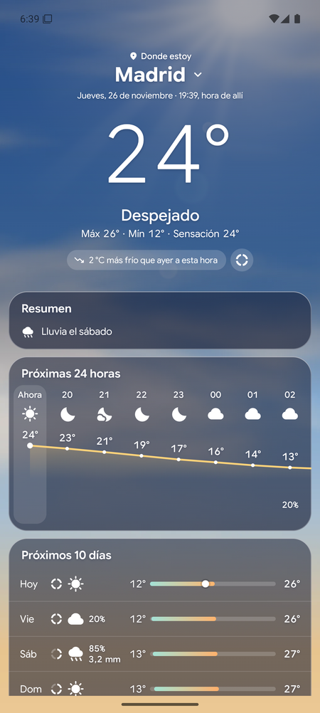
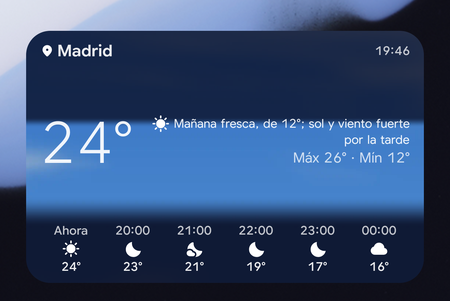
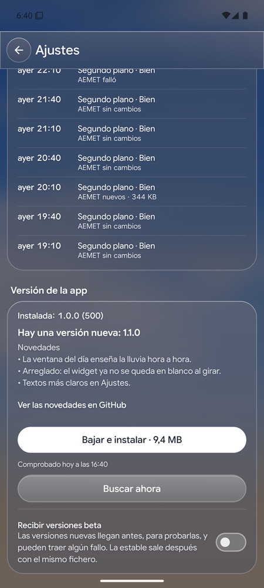

# Tiempo

Tiempo es una app del tiempo para Android, de Trastea Labs. Es de código abierto, no tiene cuentas y no recoge ningún dato.

Sirve para saber de un vistazo qué tiempo hace y hará, y la previsión está también en un widget que nunca se queda congelado.

## Qué hace

- **Donde estoy y sitios guardados:** la previsión de donde estás ahora y de los sitios que quieras guardar.
- **Widgets de 4×1 y 4×2:** para el escritorio. Pintan lo último que se descargó; no gastan batería descargando por su cuenta.
- **Avisos de AEMET:** los avisos oficiales de la Agencia Estatal de Meteorología, explicados en claro.
- **Fiabilidad:** dice cuánto te puedes fiar de la previsión de cada día.
- **Aire y polen:** calidad del aire y niveles de polen.
- **Parte con IA (opcional):** si pegas tu propia clave de un proveedor de IA, la app escribe el parte del día y contesta tus preguntas sobre el tiempo. Sin clave, la app escribe el parte con sus propias reglas y funciona igual.

## Capturas

Capturas de la demo, con datos inventados.





## Instalarla

1. Entra en las [Releases](https://github.com/trastealabs/tiempo/releases) y baja el fichero `.apk` de la última versión.
2. Ábrelo en el móvil. La primera vez, Android te pedirá permitir instalar apps desconocidas desde el navegador o el gestor de ficheros que uses.
3. Si Google Play Protect dice «Aplicación bloqueada para proteger tu dispositivo» porque no conoce a este desarrollador, toca **Más detalles › Instalar de todas formas**. Pasa con las apps que no vienen de Play Store y cuyo desarrollador Google aún no tiene registrado; puede volver a salir en cada actualización. Si prefieres comprobar antes qué instalas, el código está aquí y cada versión trae su SHA-256 en Releases.
4. Necesitas Android 12 o superior.

Después no hace falta volver a GitHub: la app avisa sola cuando hay una versión nueva y la instala cuando tú se lo pides.

## Datos que usa y de quién

- **Previsión:** [Open-Meteo.com](https://open-meteo.com/), con licencia CC BY 4.0.
- **Aire y polen:** CAMS (Copernicus), a través de Open-Meteo.
- **Avisos:** AEMET (Agencia Estatal de Meteorología), que no participa en esta app ni la patrocina.
- **Nombres de lugares:** GeoNames, con licencia CC BY 4.0.
- **Luna:** NASA.
- **Letra:** Google Sans Flex, con licencia OFL.

La lista completa, con las librerías de terceros y sus licencias, está en Ajustes › Acerca de.

## Privacidad, en corto

El estudio no recoge nada: sin cuentas, sin analíticas, sin anuncios, sin rastreo. Tu ubicación solo sale hacia Open-Meteo, redondeada a 2 decimales. Si pones una clave de IA, a tu proveedor le llegan cifras y horas de la previsión (sin tu ubicación ni el nombre del sitio) y tus preguntas tal cual. Todo lo demás se queda en tu móvil. Los detalles están en [PRIVACY.md](PRIVACY.md).

## Compilarla

Necesitas el JDK que trae Android Studio.

```
./gradlew assembleDebug
./gradlew installDebug
```

`installDebug` instala «Tiempo dev» en el móvil o el emulador conectado. La versión de release necesita una clave de firma propia: se le pasa con las variables `RELEASE_KEYSTORE_FILE`, `RELEASE_KEYSTORE_PASSWORD`, `RELEASE_KEY_ALIAS` y `RELEASE_KEY_PASSWORD`.

Para colaborar, mira [CONTRIBUTING.md](CONTRIBUTING.md). Para avisar de un fallo de seguridad, [SECURITY.md](SECURITY.md).

## Contacto

Fallos e ideas, en los [issues](https://github.com/trastealabs/tiempo/issues). Para lo demás, hola@trastealabs.com.

## Cómo se hace

Tiempo se hace con ayuda de IA: el código lo escribe Claude Code, dirigido por una persona, y el trabajo se organiza con Becario, un plugin de Claude Code.

## Licencia

GPL-3.0 (ver [LICENSE](LICENSE)). © 2026 Álvaro García (Trastea Labs).

El nombre «Tiempo», el nombre «Trastea Labs» y el icono no entran en la licencia. Quien publique una copia modificada debe hacerlo con otro nombre y otro icono.
